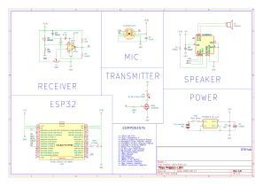
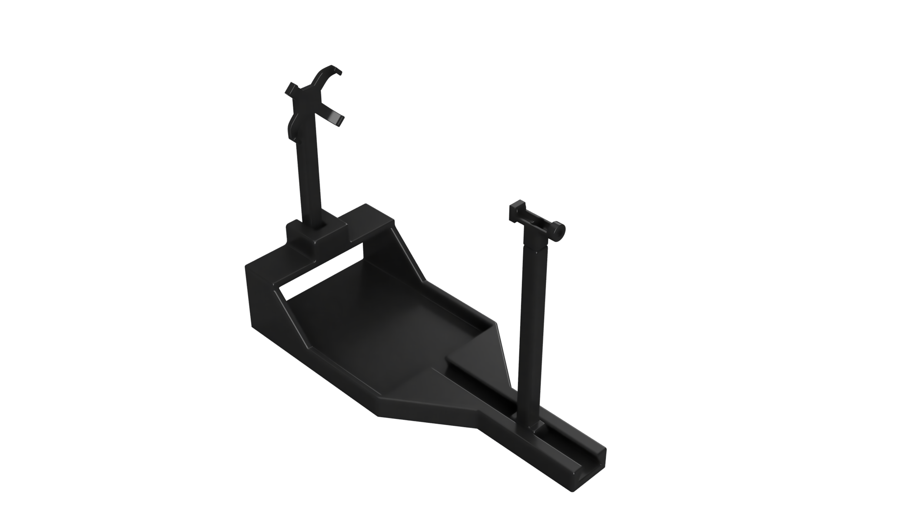
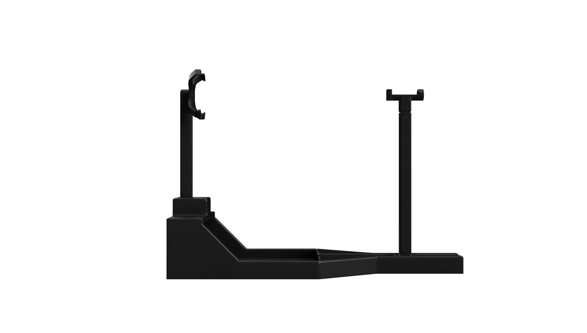
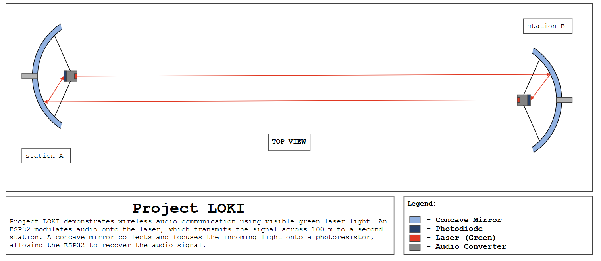

# 🚀 Project Loki: Bidirectional Free-Space Optical Communication

**Project Loki** is a two-way laser communication system built for the NIMS Dubai Expo. It demonstrates Free-Space Optical (FSO) technology, similar to what modern satellites use, by transmitting data wirelessly through beams of light instead of radio waves.

The project features **two identical transceiver stations**. Both stations can send and receive audio data at the same time over a single optical link.

---

## 🌟 Key Features
* **Two-Way Link:** Simultaneous transmission and reception (Full-Duplex).
* **Signal Conditioning:** A comparator turns weak photodiode light signals into sharp digital square waves.
* **Logic-Level Control:** Low-power ESP32 pins safely switch a 5V laser using a MOSFET.
* **Dual Demo Inputs:** Supports live voice from a microphone or digital MP3 file streaming.

---

## 🛠️ How It Works

### Signal Flow
![Project Loki Transceiver Diagram](https://kroki.io/plantuml/svg/eNqtVm1v2kgQ_u5fMSJSk0ixitemgRO1uhi7RWcDwk4bqeqHBRawYrxovVwvd8p_v_VL8BaTNNdmI0Vo5tmZ2efZGe-HTBAu9ttEOwdd18FJKEkh4iTNdoTTVMCUsxXNspilJIGQiv0uB2rZXZxKBNnCnCzu1pzt0-WCJYyDqDcrqAXb7lgqbaG4TyhwuhAkXSdUgQzpiuwT4bFUjMmWQiuka0bhZtS6AsxjklxBJkPrGeXx6vQ-p6jgzHBRzxychoTxPxQMU3HO8todxlPKoavYww1Zsu9xuoYVSTKqVRRJM9_Bp3i90R0Zj5NMkkQSKgQ9YmYnmSFrCv9qINfgwFNVpdf1sOeUPsaXlFf2noXNQbewK2dqe8Y1wgdrSeOcJUvtQVNyrqRFnuOplMVqpnQGw45rHKc0TcvodH6Mf9CxSnFeXpZtLI_PJQ9iAxflJRoke3r5RBltr3eqjDbqWs514-Tmux4ui6tSzuiCxn8d5fvIKU2fTjj0rGZC4x02LXyc0Oh02-YwP_c5vP_FJbeGEY5GkzG0jd-J83iJWnW4FvT7oSBC9qRtVzoU_yrxW6okoew0CYSL6PayVYHz9XU0DqaWZcAIhRDEi29AMgiM2u-GU91EEDg3hcs1ZNbo1rZrxFiP7ncUgknouVG5f9JEdT5LvZbgE9m3MIzZkhZQv4E8_AgM0LnsL6Hb4NYVuYpZJqrhE8Xhl_aHJimHS3NgZHbEyGD6xbRgumGCLQ91TvM6Zz-cyA_MngmO7ATZEoLxAuc0cTWDUFI4a2ICfNvrmp1rXOgwxE6BxE1gV59s5EzaUXJHy4yh0aRuqlDh1H5HZXSmUDpTHLi2Y8UcPjL6av2AXrcf0E_74aT08ALt0Qu1R89p_yg--rn4JRSj59UvUSE6IT9S5K_9DlLlR4r8igPXdqyYqzQPL58y8NyYKWsP0GmmKqrQ86OmijFBL5g1JdZHTw8blRuFGqQOG6QMG8Xho1dqjck0GjnYBx-H7gz80fjPEC6-xPLjdpPmFzeTby_5fbuHiP4t4A18jrN4Lr__mHP2Pbv8neRyDutfz1zPkusqf098k48YeTZ5lf6A_kp-FaF4170_uzbkH7b7c7vkd0Dle8DZkDSlCRj9t3O7_zbH21o-M_Mox4FzHf5PUKQG1T7QdLnfav8BYnfZFA==)

### Schematics (KiCad)


📄 [High-resolution schematic (PDF)](./hardware/schematic_high_res.pdf)

### 3D Model (Fusion 360)



---

## 🎧 Expo Demonstration Modes

Visitors can interact with the project in two different modes:

### 1. Live Voice Mode (Intercom Demo)
* Speak into the microphone at Station 1.
* The ESP32 digitizes the voice and sends it across the room via the laser.
* Station 2 receives the beam and plays the audio instantly through its speaker.

### 2. MP3 Music Mode (Data Streaming Demo)
* Plays an MP3 audio file from a laptop or mobile phone to the other station's speaker.
* Demonstrates that optical links can handle high-bandwidth digital data streams.

### 🖼️ Expo Setup Layout


---

## 📋 Component Checklist (Per Station)

Both stations use identical hardware:

| Role | Component |
|---|---|
| **Brain** | 1x ESP32 DevKit V1 (30-pin) |
| **Light Source** | 1x 5V Laser Diode Module |
| **MOSFET** | 1x ZVN2106 |
| **Receiver** | 1x BPW34 PIN Photodiode |
| **Signal Cleaner** | 1x LM311 Voltage Comparator |
| **Audio Input** | 1x INMP441 I2S Microphone Module |
| **Audio Output** | 1x MAX98357A I2S Amplifier Module + 8Ω Speaker |
| **Power Source** | 2x 18650 Li-ion (2S, 7.4V nominal) |
| **Regulator** | 1x MP1584EN 5V Buck Module |
| **Passives** | 1x 10kΩ potentiometer, 1x 100Ω, 2x 1kΩ, 1x 100kΩ resistors, 3x 0.1µF, 1x 10µF, 1x 1000µF capacitors |

---

## 🔬 Core Scientific Principles

* **Photoconductive Mode:** The BPW34 is reverse-biased so it reacts fast enough to catch digital audio frequencies.
* **Threshold Adjustment:** The comparator ignores background room light by responding only to the intense laser brightness.
* **Low-Side Switching:** The MOSFET bridges the 3.3V microcontroller logic and the 5V laser supply safely on the ground line.

---

## 📁 Repository Structure

```
Project-Loki/
├── README.md
├── images/        # Expo layout and 3D model renders
└── hardware/      # KiCad schematic (SVG + PDF)
```
